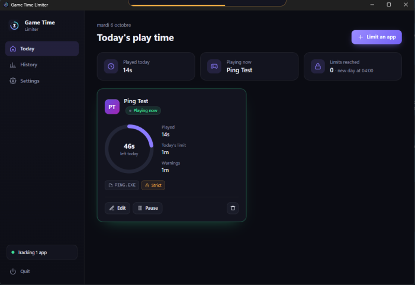
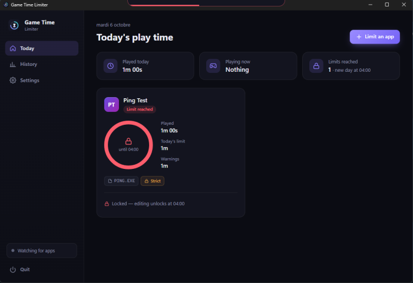
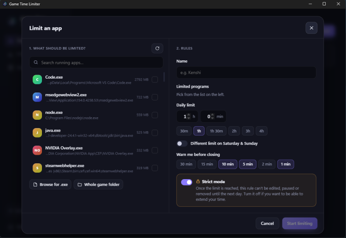

# Game Time Limiter

Daily play-time limits for any game or app on Windows. Built with Tauri 2 (Rust) + React.



## Download

Get the latest `_x64-setup.exe` installer from the [Releases](../../releases/latest) page and run it (no admin rights needed). The app starts with Windows and lives in the system tray.

| Limit reached | Adding an app |
| --- | --- |
|  |  |

## How it works

- **Limit any app.** Pick it from the list of running apps, browse for its `.exe`, or select a whole game folder (every program inside it counts).
- **Counts real play time.** Time only counts while the app is running. Several apps can be limited at the same time, each with its own budget.
- **Warnings before closing.** Shows an always-on-top banner, plays a beep and sends a Windows notification at the warning points you choose (default: 10, 5 and 1 minutes left).
- **Closes it and keeps it closed.** When the limit is reached the app is killed, and it's killed again every time it's relaunched until the next day.
- **Extra time after the limit (per app).** After time's up you can come back for 5, then 2, then 1 more minute, with a 5-minute cooldown between each, to finish what you were doing. Then it's locked for the day.
- **Your own warning sound.** Pick any audio file in Settings (the first 10 seconds are played), or keep the built-in beep.
- **Strict mode (per app).** Once the limit is reached the rule can't be edited, paused or removed until the next day. Turn it off for apps where you want to be able to extend your time.
- **Updates itself.** Checks GitHub every few hours and installs new versions on its own, never while a limited app is running (can be turned off in Settings).
- **New day at 04:00 by default** (configurable), so playing past midnight doesn't reset your limit.
- Weekend limits, a 7/14/30-day history, a 0-minute limit to block an app completely.

### Hard to bypass, not impossible

- Closing the window hides it to the tray. Installed builds start with Windows in the tray.
- Quit protection refuses to quit while a limited app is running or locked.
- Moving the system clock forward while the limiter runs, or backward at any time, is ignored.
- Someone determined can still end the process from Task Manager or rename the game's `.exe`. Use the folder target to cover renamed exes.

Data is stored in `%APPDATA%\com.rayan.gametimelimiter\data.json`.

## Development

Requirements: Rust, Node and pnpm.

```sh
pnpm install
pnpm tauri dev      # run with hot reload
pnpm tauri build    # installer in src-tauri/target/release/bundle/nsis/
```

## Releasing

Bump `version` in `package.json`, `src-tauri/Cargo.toml` and `src-tauri/tauri.conf.json`, then push a tag:

```sh
git tag v1.0.1
git push origin v1.0.1
```

GitHub Actions builds the installer and publishes the release.
